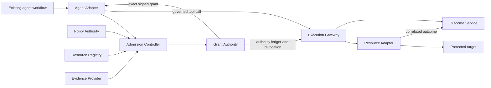

# KedgeFlow

KedgeFlow proposes component boundaries and programmable interfaces for control
over consequential agent actions. An existing agent workflow proposes an exact
action; independently administered control services admit it and issue bounded
authority; an Execution Gateway and Resource Adapter enforce the protected effect.

This repository contains the **Rust `0.9.0-alpha.1` reference implementation**,
a **Node Agent Adapter**, and the preserved language-independent **KF-JSON-0.2
schemas and signed fixtures**. The Python `0.1.0a1` package is a separate legacy
demo. The protocols remain proposed; the Rust services implement a bounded
single-action profile, with software verification through **M5c3 as of
12 October 2026**. Enterprise acceptance and release conformance remain open.

The [white paper v0.9](docs/whitepaper/v0.9/output/pdf/kedgeflow-whitepaper.pdf)
was frozen on 6 October 2026. Its schema and all 22 shared fixture files remain
byte-identical. The [milestone plan](docs/IMPLEMENTATION_ROADMAP.md) tracks delivered
increments and release gates; [remaining enterprise work](docs/ENTERPRISE_QUALIFICATION.md)
identifies the inputs needed to proceed. [RFCs 0001–0022](docs/rfcs/README.md) are
engineering drafts, and the [profile index](docs/PROTOCOL_PROFILES.md) distinguishes
implemented draft bindings from proposed and legacy contracts.



## Implementation state

| Area | Implemented and tested | Limits and remaining acceptance |
| --- | --- | --- |
| Records and execution | Closed integer-only canonical JSON, Ed25519 signatures and digests; authenticated Model Context Protocol (MCP) discovery/remediation/calls under `KF-MCP-0.1` and revision `2026-07-28`; atomic etcd issuance, replacement, claim, dispatch and outbox | One-resource leaf profile described below; target effects remain outside ledger transactions |
| Admission and control (M2) | Signed proposal/descriptor/manifest/evidence verification, Cedar evaluation, constrained certificates, operation-wide issuance deduplication, issuer-owned IDs/nonces/fences; native admission/issuer and signed administration/install/revoke services with gateway acknowledgements | Approved policy/provider pins, production enrollment/RBAC, broader component coverage, counter bootstrap and migration |
| Agent integration (M3a–M3b) | [Node Agent Adapter](docs/AGENT_ADAPTER.md) with official MCP client 2.3.0, fresh admission/issuance, grant persistence before execution, retained attempt status and signed-proposal lookup after ambiguous replies | Reference mock action; real evidence providers, power-loss storage and crash-lock recovery remain unqualified |
| Outcomes and history (M4a–M4b4) | [Query-only recovery](docs/RECOVERY_SERVICE.md), signed receipts, authenticated [collector](docs/OUTCOME_REPORT_SERVICE.md), durable acknowledgements; offline [admission lineage](docs/ADMISSION_LINEAGE.md), [governance history](docs/CONTROL_HISTORY.md) and [control-binding](docs/CONTROL_BINDINGS.md) verification | Observer/ledger correctness, clock and historical key custody remain trusted; verification does not establish actual target effects |
| Failure handling (M4c1–M4c3) | Nine shipping-binary [process kill/restart cases](docs/PROCESS_CRASH_RECOVERY.md); independent write-ahead [restore quarantine](docs/RESTORE_QUARANTINE.md); [owned unknown incidents and ordered automatic delivery](docs/OUTCOME_SUPERVISION.md) | Same-host software fixtures; pending-witness repair, migration, physical failure domains, external incident routing and combined managed restore deployment remain open |
| Identity and credentials (M5a–M5c3) | Optional [shared DPoP replay/registration](docs/SHARED_AUTHENTICATION.md); [original-claim broker authorization](docs/BROKER_AUTHORIZATION.md); [subject/JWT-SVID signatures](docs/EXCHANGE_IDENTITIES.md); native [one-shot token exchange](docs/BROKER_TOKEN_SERVICE.md) and separately verified reference target token; per-exchange [signed identity refresh](docs/IDENTITY_REFRESH.md) with live key rotation and rollback refusal | Actual AS/SVID provisioning, publisher administration, independent head/floor custody, production credential/RBAC/bypass controls and actual target token enforcement remain open |
| Enterprise and wider protocols (M6–M9) | Roadmap and acceptance requirements | Real PostgreSQL action/pilot, Rust human-review/lease path with enrolled hardware, reservations/delegation/saga/drain and independent protocol peers remain future milestones |

The executable grant profile supports **one nondelegated resource, one `version_eq`
predicate, `Level_A` / `FencingToken`, and `dispatch_bound` completion**. Other
guards, multiple predicates/resources, delegated grants, saga execution and
`commit_bound` validity are refused. The bounded Resource Adapter uses a fixed
HTTPS fenced mock-target contract. A correlated terminal mock receipt can establish
mock commit; a generic MCP success, tool error, timeout or asynchronous acceptance
cannot establish commit or absence of an effect.

Unknown attempts remain consumed. Recovery and status queries do not retry
mutations or refund authority. The native broker authorizes one mint from the
original undispatched claim; failed or lost mint replies do not permit another
mint, and no token redelivery API is supplied. Its reference target credential
requires the separately implemented target-side guard/effect/outcome contract.

The next acceptance gate is **M5c approved identity/credential providers and
protected deployment custody**, followed by **M6's real PostgreSQL target and
isolated enterprise pilot**. The delivered M5c1–M5c3 software prerequisites do not
close that gate. M0 toolchain/reproduction qualification and M1 owner acceptance
also remain open; full M2–M4 deployment gates remain tracked in the roadmap.

## Build and verify

The workspace declares Rust 1.88 or newer; the SDK harness declares Node 20 or
newer. The latest retained required-mode run used **Rust 1.98.0, Node 25.2.1 and
etcd 3.6.5 on Darwin ARM64**. Execution on the declared minimum Rust/Node versions
remains unqualified. Rust dependencies are fixed in `Cargo.lock`; the official
MCP client is pinned in `tests/sdk/package-lock.json`.

```sh
cargo build --locked --workspace --bins
cargo run --locked --bin kf-proxy -- --help
cargo run --locked --bin kf-broker -- --help
cargo fmt --all -- --check
cargo clippy --locked --workspace --all-targets -- -D warnings
python scripts/verify-whitepaper.py
```

Run the full suite with a real three-member etcd 3.6.5 cluster and the pinned
MCP client SDK:

```sh
npm ci --prefix tests/sdk
KF_REQUIRE_SDK=1 ETCD_BINARY=/absolute/path/to/etcd scripts/start-etcd.sh -- \
  cargo test --locked --workspace --all-targets -- --nocapture --test-threads=1
node tests/sdk/agent-vectors.mjs
```

See [real-etcd testing](docs/ETCD_TESTING.md) for Bash, curl and cluster prerequisites.
The retained run serialized test cases to fit host disk capacity; explicit actor
concurrency still races inside tests. A plain `cargo test` can skip tests requiring
unconfigured external dependencies. Required mode and [CI](.github/workflows/ci.yml)
fail if those dependencies are absent.

The [12 October M5c3 verification](results/verification/rfc-m5-refresh-2026-10-12/README.md)
retains **233 Rust tests passing, zero failures/ignored/skipped**, required etcd
and SDK, Clippy, formatting, Node vectors, frozen-paper and schema checks. Its
[summary](results/verification/rfc-m5-refresh-2026-10-12/summary.json) pins the tested
sources and environment. This is retained software evidence from a same-host
fixture deployment; it does not establish production qualification or distributed
failure-domain independence. The [paper artifact](artifacts/short-paper/README.md)
is a separate pinned historical reproduction, with its own counts and sources.

## Services and tools

`cargo build --locked --workspace --bins` builds all twelve Rust executables.
Provision protected material using the linked guides and configuration templates;
the examples contain placeholders and are not an enrolled deployment.

| Executable | Purpose | Guide / configuration |
| --- | --- | --- |
| `kf-proxy` | Authenticated MCP execution/discovery and negotiated retained status | [Gateway guide](docs/RUST_GATEWAY.md), [gateway config](config/gateway.example.json) |
| `kf-control` | Authenticated admission, issuance and operation lookup | [Control guide](docs/CONTROL_SERVICE.md), [control config](config/control.example.json) |
| `kf-governance` | Authorized signed policy/registry publication, installation and revocation | [Governance guide](docs/GOVERNANCE_SERVICE.md), [governance config](config/governance.example.json) |
| `kf-broker` | One-shot RFC 8693 exchange with KedgeFlow grant/attempt extension and reference target mint | [Broker guide](docs/BROKER_TOKEN_SERVICE.md), [static config](config/broker.example.json), [signed-refresh config](config/broker-refresh.example.json) |
| `kf-recover` | Query-only retained-attempt recovery and receipt signing | [Recovery guide](docs/RECOVERY_SERVICE.md), [recovery config](config/recovery.example.json) |
| `kf-outcomes` | Authenticated retained receipt collector and signed delivery acknowledgements | [Collector guide](docs/OUTCOME_REPORT_SERVICE.md), [collector config](config/outcomes.example.json) |
| `kf-supervise` | Owned unknown deadlines, recovery polling and ordered delivery | [Supervision guide](docs/OUTCOME_SUPERVISION.md), [supervision config](config/supervision.example.json) |
| `kf-restore` | Privileged empty-namespace witness enrollment and live status checks | [Restore guide](docs/RESTORE_QUARANTINE.md) |
| `kf-verify-outcomes` | Offline grant/receipt-chain verification | [Recovery guide](docs/RECOVERY_SERVICE.md) |
| `kf-verify-lineage` | Offline signed admission-lineage verification | [Lineage guide](docs/ADMISSION_LINEAGE.md) |
| `kf-verify-history` | Offline observer-attested governance/key-history verification | [History guide](docs/CONTROL_HISTORY.md) |
| `kf-verify-control-bindings` | Offline per-transition control comparison verification | [Control-bindings guide](docs/CONTROL_BINDINGS.md) |

## Run the gateway and broker

Provision independently trusted identity, authority, credential and target
services. Keep configuration, keys, actor assertions and backing target
credentials outside the agent's authority domain.

```sh
cargo run --locked --bin kf-proxy -- --config /etc/kedgeflow/gateway.json --check
cargo run --locked --bin kf-proxy -- --config /etc/kedgeflow/gateway.json
cargo run --locked --bin kf-broker -- --config /etc/kedgeflow/broker.json --check
cargo run --locked --bin kf-broker -- --config /etc/kedgeflow/broker.json
```

These `--check` commands validate configuration and local TLS/identity material;
they do not probe remote services, publish authority or certify current provider
freshness. Native services require HTTPS and verified client certificates.
Admission/issuance and administrative operations have separate authenticated
service boundaries. Managed configurations require live installed-state checks
and gateway acknowledgement renewal; legacy direct publication/issuance/replacement
ports refuse managed domains.

Broker static mode requires protected restart to reload identity snapshots.
Signed-refresh mode reads authenticated snapshots against an exact protected head
on every exchange; it requires an external approved publisher and independently
retained head/floor. The broker does not publish updates or advance that floor.
The execution-grant `gateway_audience` and subject-token `delegation_audience`
are separate pins. The custom exchange extension and reference target token are
draft bindings; a third-party authorization server or target needs an explicitly
compatible integration.

Optional `KF-GRANT-REF-0.1` retrieval supplies a pinned mTLS resolver with requester
scope/size/time limits. Its grant store still needs independently administered
publication, authorization, retention and rate controls. The target must implement
its declared fenced transaction and correlated outcome contract; configuration
alone cannot supply target atomicity.

For local agents, loopback access and MCP routing must be paired with operating
system isolation of native shell, filesystem, socket and network paths. The
gateway installs no workstation sandbox. See the [deployment guide](docs/RUST_GATEWAY.md)
and [enterprise gates](docs/ENTERPRISE_QUALIFICATION.md) for rollout requirements.

## Existing Python demo

The Python `0.1.0a1` package remains a compatibility and learning demo. Its
in-process HMAC authority and lifecycle use a different profile; this integration
does not convert them into v0.9 execution grants. Use Python 3.11 or newer.

```sh
python -m pip install -e '.[dev,spec]'
kedgeflow demo
ruff check .
mypy src
pytest -v
python spec/validate.py
```

The Python compatibility/freeze suite contains 32 tests. It is separate from the
retained 233-test Rust record.

[Architecture](docs/architecture.md), [implementation handoff](docs/WHITEPAPER_IMPLEMENTATION.md),
[initial review](docs/IMPLEMENTATION_REVIEW.md), [10 October review baseline](docs/IMPLEMENTATION_REVIEW_2026_10_10.md),
[paper references](docs/REFERENCE_INDEX.md), [Rust verification history](docs/RUST_VERIFICATION.md),
[schema tooling](spec/README.md), [legacy demo](docs/LEGACY_DEMO.md).
Earlier reviews and handoff counts are historical snapshots; use the milestone
plan and current verification records for subsequent implementation progress.
Licensed under [Apache 2.0](LICENSE).
