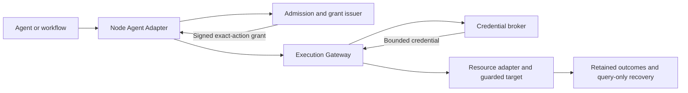

# KedgeFlow

[](https://github.com/openkedge/kedgeflow/actions/workflows/ci.yml)

**An open protocol and reference implementation for governing consequential agent actions.**

KedgeFlow separates an agent's proposed action from the authority to execute it.
Admission checks policy and evidence; an issuer signs a grant for the exact action;
a gateway, credential broker and resource adapter enforce its bounded authority.
Retained attempt records support auditing and query-only recovery when a reply is lost.
Agents and workflows integrate through the Node Agent Adapter without changing
their model provider or reasoning engine.

> **Experimental alpha — `v0.9.0-alpha.2`.** This is a software prerelease.
> The enterprise verification work provides reproducible infrastructure, test
> harnesses and acceptance checkers. Independently accepted enterprise deployment
> remains pending. See the [release notes](docs/releases/v0.9.0-alpha.2.md),
> [SQL pilot contract](docs/SQL_PILOT_RELEASE.md) and
> [production readiness gates](docs/PRODUCTION_READINESS.md).

## How it works

1. **Propose:** Bind the action, parameters, resource incarnation and expected state.
2. **Authorize:** Evaluate policy and fresh evidence, then issue a signed, time-bounded grant.
3. **Enforce:** Claim the original attempt, exchange only the permitted credential,
   and apply the registered target's guard at its declared commit point.
4. **Resolve:** Retain receipts and outcomes. An uncertain effect stays associated
   with the original attempt and is queried rather than blindly retried.



## Implemented scope and guarantees

The Rust runtime and Node adapter implement named draft profiles. Their guarantees
depend on the registered action, target guard, complete writer inventory and
protected deployment. The [profile index](docs/PROTOCOL_PROFILES.md) records the
individual contracts and remaining gaps.

| Integration | Implemented boundary | Qualification status |
| --- | --- | --- |
| PostgreSQL reservation/update | Level A for the registered conditional transaction and retained outcome COMMIT; exact incarnation, version and fence | Selected SQL pilot; disposable SQL and recovery qualification exists; deployed enterprise acceptance pending |
| Terraform saved-plan single/pair | Level C, `target_atomic:false`; retained partial/unknown outcomes | Experimental bounded integration; outside the selected SQL pilot |
| Managed Kubernetes drain | Controller acceptance; physical completion requires separate authoritative observation | Experimental bounded integration; outside the selected SQL pilot |
| Python local demo | Earlier HMAC protocol with in-process enforcement | Educational example; separate from the Rust/Ed25519 runtime |

The selected SQL profile uses a local Unix socket and kernel peer authentication:
PostgreSQL and its target service share a host under distinct non-root identities.
It does not support RDS/remote PostgreSQL or arbitrary SQL. The pilot is one
registered action/resource in an isolated organization. Multitenancy, multi-region
availability and physical-capacity scheduling have no guarantee under that contract.

## What's included

- Rust services for governance, admission, issuance, execution, credential exchange,
  retained outcomes, recovery and restore gating.
- A source-distributed Node Agent Adapter with MCP integration, evidence collection,
  persisted grant/operation status and original-attempt recovery.
- Protocol schemas, signed fixtures and conformance tests.
- Versioned Linux/systemd packaging, protected preflight, separate service identities,
  deployment manifests and operational/physical-restore harnesses.
- A self-hosted Keycloak/SPIRE identity reference and an etcd authority ledger.
- SQL pilot evidence collection and seven-owner acceptance tooling that refuses
  missing, stale, mismatched or incomplete acceptance inputs.

## Enterprise pilot status

**Milestone A — Reproducible Pilot Infrastructure:** implementation and fixture
qualification are recorded in the [Milestone A evidence](results/verification/sql-pilot-milestone-a-2026-11-14/README.md)
and subsequent exact-source CI runs. Required CI covers eleven jobs, including
MSRV, Rust, Python, dependency triage, real SQL/etcd, Kubernetes, Linux/systemd
isolation, provider lifecycle and restore tests. These use disposable environments.

**Milestone B — Enterprise Pilot Acceptance:** [AWS bootstrap](docs/CURA_AWS_BOOTSTRAP.md)
and [runtime enrollment](docs/CURA_RUNTIME_ENROLLMENT.md) have retained observations.
Application deployment and deployed end-to-end qualification remain incomplete.
Independent security review, storage/recovery and audit custody, SRE ownership,
independent reproduction and signed owner acceptance remain
**`BLOCKED_EXTERNAL_INPUT`**. Provisioned IAM roles, successful local fixtures and
passing CI do not establish independently operated enterprise acceptance.

## Get the prerelease or build from source

Use [GitHub Releases](https://github.com/openkedge/kedgeflow/releases/tag/v0.9.0-alpha.2)
for the exact asset list, source revision, checksums, CI evidence and limitations.
Binary bundles record `production_qualified:false`. Verify a downloaded Linux
bundle before staging it:

```sh
sha256sum -c SHA256SUMS
python3 scripts/verify-linux-package.py /path/to/kedgeflow-core-RELEASE-linux-ARCH-CONTENT.tar.gz
```

The checksums detect changed bytes; they are not an independent publisher signature.
The included dependency SBOM is a draft with the coverage described in the release
notes. See [Linux deployment](docs/LINUX_DEPLOYMENT.md) for protected installation,
preflight, upgrade and rollback procedures.

To build, install Rust/Cargo. [rust-toolchain.toml](rust-toolchain.toml) pins
Rust **1.98.0** for reference qualification; the declared MSRV is **1.88**.
[Cargo.lock](Cargo.lock) and [vendored patch provenance](vendor/README.md) pin the
native dependency inputs.

```sh
git clone https://github.com/openkedge/kedgeflow.git
cd kedgeflow
git checkout v0.9.0-alpha.2
cargo build --locked --workspace --bins
cargo run --locked --bin kf-proxy -- --help
```

Live services require protected configuration, TLS/workload identities, an etcd
ledger and the registered target. The [gateway](docs/RUST_GATEWAY.md),
[control service](docs/CONTROL_SERVICE.md) and [SQL pilot](docs/SQL_PILOT_RELEASE.md)
guides describe these prerequisites. Files in [config/](config/) are templates.

## Try the Python demo

Use Python 3.11 or newer for the earlier single-process learning example:

```sh
python3 -m venv .venv
. .venv/bin/activate
python -m pip install -e .
kedgeflow demo
kedgeflow demo conflict
```

It does not launch the Rust services. See the [legacy demo guide](docs/LEGACY_DEMO.md).
The Python package retains its separate `0.1.0a1` version.

## Documentation

| Topic | Guide |
| --- | --- |
| Architecture and profiles | [Component boundaries](docs/architecture.md), [profile index](docs/PROTOCOL_PROFILES.md) |
| Protocol | [Schemas and validation](spec/README.md), [draft RFCs](docs/rfcs/README.md) |
| Agent integration | [Node Agent Adapter](docs/AGENT_ADAPTER.md) |
| Credential exchange | [Broker service](docs/BROKER_TOKEN_SERVICE.md) |
| PostgreSQL | [Target service](docs/POSTGRES_TARGET_SERVICE.md), [SQL pilot contract](docs/SQL_PILOT_RELEASE.md) |
| Kubernetes | [Managed drain](docs/MANAGED_KUBERNETES_DRAIN.md) |
| Terraform | [Saved-plan inspection](docs/TERRAFORM_PLAN.md), [native apply](docs/TERRAFORM_APPLY.md), [gateway binding](docs/TERRAFORM_GATEWAY.md), [two-resource plans](docs/TERRAFORM_PAIR_GATEWAY.md) |
| Identity | [Keycloak/SPIRE reference](docs/SELF_HOSTED_PILOT.md) |
| Operations | [Linux deployment](docs/LINUX_DEPLOYMENT.md), [pilot operations](docs/PILOT_OPERATIONS.md) |
| Readiness and security | [Production gates](docs/PRODUCTION_READINESS.md), [enterprise qualification](docs/ENTERPRISE_QUALIFICATION.md), [dependency triage](docs/DEPENDENCY_SECURITY.md) |
| Design | [Frozen v0.9 white paper](docs/whitepaper/v0.9/output/pdf/kedgeflow-whitepaper.pdf) |

## Development and verification

Python **3.11–3.13** and Node **25.2.1** are the CI qualification versions.
The SDK harness declares Node 20+; that minimum is not the current qualification pin.

```sh
python -m pip install -c requirements-ci.txt -e '.[dev,spec]'
npm ci --prefix tests/sdk
cargo fmt --all -- --check
cargo clippy --locked --workspace --all-targets --features selfhosted-pilot-tests -- -D warnings
pytest
node --test tests/test_*.mjs
python spec/validate.py
python scripts/verify-whitepaper.py
```

A plain `cargo test` can skip integration cases when external fixtures are absent.
Use the pinned setups and mandatory qualification sequence in
[CI](.github/workflows/ci.yml), the [etcd testing guide](docs/ETCD_TESTING.md) and
the relevant integration guides. [Release CI verification](scripts/verify-release-ci.mjs)
requires the exact source/run attempt, all eleven jobs and every mandatory step.

## Contributing and security

See [CONTRIBUTING.md](CONTRIBUTING.md) for contributions and
[SECURITY.md](SECURITY.md) for vulnerability reporting and support boundaries.
KedgeFlow is licensed under [Apache 2.0](LICENSE); vendored dependencies retain
their [upstream notices and patch provenance](vendor/README.md).
