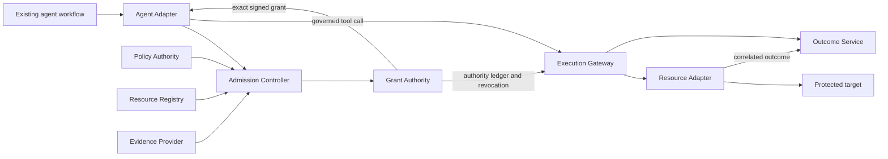

# KedgeFlow

KedgeFlow proposes component boundaries and programmable interfaces for control
over consequential agent actions. An existing agent workflow proposes an exact
action; independently administered control services admit it and issue bounded
authority; an Execution Gateway and Resource Adapter enforce the protected effect.

This repository contains the **Rust `0.9.0-alpha.1` reference implementation**,
a **Node Agent Adapter**, and the preserved language-independent **KF-JSON-0.2
schemas and signed fixtures**. The Python `0.1.0a1` package is a separate legacy
demo. The protocols remain proposed; the Rust services implement a bounded
single-action profile, with additional **M6d2b/M6d3a and M7a/M7b/M7c/M7d1/M7d2/M8a/M8b1/M8b2/M8c1/M9a software
prerequisites as of 14 October 2026**. These add pinned SQL peer transport,
logical restore rehearsal, native reviewed evidence/static leases, reservation
libraries, native fixed-cost leaf reservations with signed history/refinement,
authenticated A2A root-reference views, and a conformance runner.
Enterprise acceptance, physical storage/restore qualification and release
conformance remain open.

The [white paper v0.9](docs/whitepaper/v0.9/output/pdf/kedgeflow-whitepaper.pdf)
was frozen on 6 October 2026. Its schema and all 22 shared fixture files remain
byte-identical. The [milestone plan](docs/IMPLEMENTATION_ROADMAP.md) tracks delivered
increments and release gates; [remaining enterprise work](docs/ENTERPRISE_QUALIFICATION.md)
identifies the inputs needed to proceed. [RFCs 0001–0040](docs/rfcs/README.md) are
engineering drafts, and the [profile index](docs/PROTOCOL_PROFILES.md) distinguishes
implemented draft bindings from proposed and legacy contracts.



## Implementation state

| Area | Implemented and tested | Limits and remaining acceptance |
| --- | --- | --- |
| Records and execution | Closed integer-only canonical JSON, Ed25519 signatures and digests; authenticated Model Context Protocol (MCP) discovery/remediation/calls under `KF-MCP-0.1` and revision `2026-07-28`; atomic etcd issuance, replacement, claim, dispatch and outbox | One-resource leaf profile described below; target effects remain outside ledger transactions |
| Admission and control (M2) | Signed proposal/descriptor/manifest/evidence verification, Cedar evaluation, constrained certificates, operation-wide issuance deduplication, issuer-owned IDs/nonces/fences; native admission/issuer and signed administration/install/revoke services with gateway acknowledgements | Approved policy/provider pins, production enrollment/RBAC, broader component coverage, counter bootstrap and migration |
| Agent integration (M3a–M3b) | [Node Agent Adapter](docs/AGENT_ADAPTER.md) with official MCP client 2.3.0, fresh admission/issuance, grant persistence before execution, retained attempt status and signed-proposal lookup after ambiguous replies | Mock or named PostgreSQL action; real evidence providers, power-loss storage and crash-lock recovery remain unqualified |
| Outcomes and history (M4a–M4b4) | [Query-only recovery](docs/RECOVERY_SERVICE.md), signed receipts, authenticated [collector](docs/OUTCOME_REPORT_SERVICE.md), durable acknowledgements; offline [admission lineage](docs/ADMISSION_LINEAGE.md), [governance history](docs/CONTROL_HISTORY.md) and [control-binding](docs/CONTROL_BINDINGS.md) verification | Observer/ledger correctness, clock and historical key custody remain trusted; verification does not establish actual target effects |
| Failure handling (M4c1–M4c3) | Nine shipping-binary [process kill/restart cases](docs/PROCESS_CRASH_RECOVERY.md); independent write-ahead [restore quarantine](docs/RESTORE_QUARANTINE.md); [owned unknown incidents and ordered automatic delivery](docs/OUTCOME_SUPERVISION.md) | Same-host software fixtures; pending-witness repair, migration, physical failure domains, external incident routing and combined managed restore deployment remain open |
| Identity and credentials (M5a–M5c3) | Optional [shared DPoP replay/registration](docs/SHARED_AUTHENTICATION.md); [original-claim broker authorization](docs/BROKER_AUTHORIZATION.md); [subject/JWT-SVID signatures](docs/EXCHANGE_IDENTITIES.md); native [one-shot token exchange](docs/BROKER_TOKEN_SERVICE.md) and separately verified reference target token; per-exchange [signed identity refresh](docs/IDENTITY_REFRESH.md) with live key rotation and rollback refusal | Actual AS/SVID provisioning, publisher administration, independent head/floor custody, production credential/RBAC/bypass controls and provider-specific target tokens remain open; native SQL verifies its reference token |
| PostgreSQL storage (M6a) | [Conditional reservation update](docs/POSTGRES_RESERVATION.md), atomic version/incarnation/fence checks, retained attempt/root/grant deduplication and query; real PostgreSQL concurrency, rollback, replay, missing-status and restart tests | M6b1 supplies the native target/query and M6b2 connects the fresh signed leaf path; production writer/bypass/restore qualification remains open |
| Native PostgreSQL target (M6b1) | [Authenticated target/query service](docs/POSTGRES_TARGET_SERVICE.md), fixed Unix-socket driver, explicit COMMIT acknowledgement, independent signed grant/reference-token checks, fixed adapter client and shipping process restart | Six target tests use generated preissued authority; M6b2 adds fresh admission/issuer/native broker/SQL recovery composition |
| PostgreSQL leaf binding (M6b2) | [Named SQL action](docs/rfcs/0025-postgres-leaf-binding.md), exact CTD schema, explicit gateway adapter, official Node client, native broker/SQL commit and lost-target-reply recovery | Disposable same-host SQL and generated identity/evidence; M6c adds bounded crash/restore/incident composition; enterprise acceptance remains open |
| SQL failure qualification (M6c) | [Eleven combined cases](docs/SQL_FAILURE_QUALIFICATION.md): shipping gateway/broker/target/recovery/supervisor kills, witnessed quarantine, retained incidents and signed collector acknowledgements | Stopped logical ledger restore only; pending repair, stale SQL backup/storage loss, deployed custody/writer coverage and independent collector storage remain open |
| SQL enrollment (M6d1) | [Shared runtime/preflight check](docs/POSTGRES_ENROLLMENT.md): standalone function roles, effective column/PUBLIC grants, membership/delegation, database ownership/CREATE and admin/replication refusal; explicit read-only `--check-database` | Catalog observation only; deployed OS/socket/peer and secret custody, administrator changes and enterprise acceptance remain open |
| SQL target custody (M6d2a) | [Explicit protected-file loading](docs/POSTGRES_CUSTODY.md), verified descriptor/mode snapshots, native custody check and real PostgreSQL peer-map negatives | Same-UID fixture; independent OS accounts, ACL/mount/socket administration, rotation, other service loaders and deployed agent bypass coverage remain open |
| SQL transport/restore prerequisites | [Kernel peer pin before SQL bytes and fenced stale logical restore](docs/MILESTONE_PREREQUISITES.md), external lost-commit history and storage budget; Linux separate-account CI harness | Linux account observation pending; all-service custody/rotation, physical restore/cutover/retention and accepted pilot open |
| Review integration (M7a/M7b) | [Native review provider](docs/NATIVE_REVIEW.md), closed signed evidence, server rendering and consumed challenge/enrollment comparisons in admission/issuance | Software authenticator, native revocation races and shipping crash/retry tested; browser/physical enrollment/hardware and frozen HITL open |
| Static leases and audit (M7c/M7d1/M7d2) | [Exact-proposal prevalidation](docs/STATIC_ADMISSION_LEASES.md), retained static discharges, fresh JIT evidence and membership generation/CAS through native admission/issuance | Shipping crash/retry, withdrawal races and [v0.2 historical lease verification](docs/LEASED_AUTHORIZATION_LINEAGE.md) tested; [Node static-cache/JIT acquisition](docs/AGENT_STATIC_LEASES.md) delivered; approved membership/provider lifecycle and hardware qualification open |
| Reservations (M8a/M8b1/M8b2) | [Hierarchical capacity state](docs/rfcs/0032-coordination-reservations.md) and [native fixed-cost leaf issuance/claim/dispatch](docs/NATIVE_RESERVED_LEAF.md); allocation shares the fence transaction and claim holds unknown with the original attempt | [Opt-in v0.2 history and native signed-outcome refinement](docs/RESERVED_HISTORY.md), contention, stop/receipt races and shipping SDK/CLI recovery tested; allowances stay held; hierarchical execution grants, full A2A peers, saga/compensation/drain remain open |
| A2A root views (M8c1) | [Activated root-reference resolution](docs/A2A_ROOT_RESOLUTION.md), immutable reader ACL, narrowed action/resource views, pinned mTLS client and shipping control CLI | Read-only draft extension; no allocation or child execution authority, core A2A task server or independently accepted peer |
| Conformance prerequisite (M9a) | [Required software runner](docs/rfcs/0033-release-conformance.md), source/tool/log pins and explicit open release gates | Independent controller, second runtime/target and reproduced release acceptance open |
| Enterprise and wider protocols (M6–M9) | Roadmap and acceptance requirements | Complete real-target pilot, Rust human-review/lease path with enrolled hardware, reservations/delegation/saga/drain and independent protocol peers remain future milestones |

The executable grant profile supports **one nondelegated resource, one `version_eq`
predicate, `Level_A` / `FencingToken`, and `dispatch_bound` completion**. Other
guards, multiple predicates/resources, delegated grants, saga execution and
`commit_bound` validity are refused. Protected gateway configuration selects a
fixed HTTPS fenced mock target or the explicit RFC 0025 SQL reservation adapter.
An authenticated, exactly correlated terminal receipt establishes that target's
commit. Generic MCP success, tool error, timeout or asynchronous acceptance cannot
establish commit or absence of an effect.

The baseline must match the active CTD's registered version_eq clause. Subsequent
versions require an updated registered descriptor; automated rollover remains
unqualified.

Unknown attempts remain consumed. Recovery and status queries do not retry
mutations or refund authority. The native broker authorizes one mint from the
original undispatched claim; failed or lost mint replies do not permit another
mint, and no token redelivery API is supplied. Its reference target credential
requires the separately implemented target-side guard/effect/outcome contract.

The next acceptance gate is **M5c approved identity/credential providers and
protected deployment custody**, followed by **M6's isolated enterprise pilot
acceptance**. M6c qualifies the bounded disposable SQL failure composition. The
delivered M5c1–M5c3 software prerequisites do not close that gate. M0 toolchain/reproduction qualification and M1 owner acceptance
also remain open; full M2–M4 deployment gates remain tracked in the roadmap.

## Build and verify

The workspace declares Rust 1.88 or newer; the SDK harness declares Node 20 or
newer. The latest retained required-mode run used **Rust 1.98.0, Node 25.2.1 and
etcd 3.6.5 on Darwin ARM64**. Execution on the declared minimum Rust/Node versions
remains unqualified. Rust dependencies are fixed in `Cargo.lock`; the official
MCP client is pinned in `tests/sdk/package-lock.json`.

```sh
cargo build --locked --workspace --bins
cargo run --locked --bin kf-proxy -- --help
cargo run --locked --bin kf-broker -- --help
cargo fmt --all -- --check
cargo clippy --locked --workspace --all-targets -- -D warnings
python scripts/verify-whitepaper.py
```

Run the full Rust suite with PostgreSQL 18.3 server/client binaries, a real
three-member etcd 3.6.5 cluster and the pinned MCP client SDK:

```sh
npm ci --prefix tests/sdk
KF_REQUIRE_SDK=1 ETCD_BINARY=/absolute/path/to/etcd \
  python scripts/test-postgres.py --bindir /absolute/path/to/postgresql-18.3/bin --peer --recovery-rehearsal \
  --command scripts/start-etcd.sh -- \
  cargo test --locked --workspace --all-targets -- --nocapture --test-threads=1
node tests/sdk/agent-vectors.mjs
node tests/sdk/lease-vectors.mjs
```

See [real-etcd testing](docs/ETCD_TESTING.md) for Bash, curl and cluster prerequisites.
The retained run serialized test cases to fit host disk capacity; explicit actor
concurrency still races inside tests. A plain `cargo test` can skip tests requiring
unconfigured etcd, SDK or PostgreSQL dependencies. The SQL CI job requires
the disposable database, etcd and official SDK for target, fresh SQL leaf and combined failure tests. Required mode and [CI](.github/workflows/ci.yml)
fail if those dependencies are absent.

Use [the conformance runner](docs/MILESTONE_PREREQUISITES.md) for one source-pinned
required-mode bundle. The [A2A root-resolution verification](results/verification/rfc-m8-a2a-root-2026-10-14/README.md)
records **343 Rust tests across 46 binaries**, **18 SQL storage/peer/restore groups**
and **32 Python tests**, plus agent/lease client vectors and quality checks. It
includes twelve A2A root-view groups covering native TLS/DPoP/etcd, scoped
hierarchical views, permanent withdrawal, shipping process restart, pinned client
negatives and unchanged native v0.2 history/capacity. It retains the existing
reservation/recovery/SDK corpus. Browser/hardware, hierarchical execution grants,
full A2A peers, saga/drain and enterprise acceptance remain open.
The preceding [M8b2 record](results/verification/rfc-m8-reserved-history-2026-10-14/README.md)
retains the 331-test implementation.
The preceding [M8b1 record](results/verification/rfc-m8-reserved-leaf-2026-10-14/README.md)
retains the 320-test implementation. Separate Linux account and minimum Rust CI
execution are unobserved locally.

The earlier [M6d2a verification](results/verification/rfc-m6-custody-2026-10-13/README.md)
records **269 Rust tests across 40 binaries**, **15 SQL storage/peer groups** and
**32 Python tests**, with no Rust failures/ignored/skipped and SQL/etcd/SDK required.
The shipping target consumes protected file bytes under explicit custody mode;
the required SQL run now uses actual kernel peer authentication. This is same-UID
mechanics, not deployed account isolation or enterprise acceptance.

The [M6d1 verification](results/verification/rfc-m6-enrollment-2026-10-13/README.md)
records **263 Rust tests passing with no failures/ignored/skipped**, **11 real SQL
storage groups** and **32 Python tests**. Three isolated enrollment groups prove
column and SET ROLE bypasses and verify preflight/runtime refusal. The shipping
CLI checks both fixed roles without a listener or probe mutation; the existing
`--check` remains offline. This tightens supported role enrollment.

The [M6c verification](results/verification/rfc-m6-failure-2026-10-13/README.md)
records **260 Rust tests passing with no failures/ignored/skipped**, including
**11 fresh SQL failure/restore/incident cases**, plus **11 real PostgreSQL storage
groups**. Recovery retains the original attempt and consumed authority without
another mint or mutation. The collector uses shared retained receipt storage;
logical ledger rollback is refused against a separately retained witness.
[M6b2](results/verification/rfc-m6-leaf-2026-10-13/README.md) retains its 249-test run
and deterministic ID-schema regression covering all 256 leading entropy bytes.
[M6b1](results/verification/rfc-m6-target-2026-10-12/README.md) retains its 243-test run. [M6a](results/verification/rfc-m6-postgres-2026-10-12/README.md)
retains 237 passing Rust tests for its pinned sources; [M5c3](results/verification/rfc-m5-refresh-2026-10-12/README.md)
retains its earlier 233-test run. These are same-host software fixtures with generated
authority, not production or distributed failure-domain qualification. The
[paper artifact](artifacts/short-paper/README.md) is a separate historical reproduction.

Run the SQL and native mTLS target cases with PostgreSQL 18.3 server/client binaries;
the launcher creates only its own disposable Unix-socket database:

```sh
python scripts/test-postgres.py --bindir /absolute/path/to/postgresql-18.3/bin --peer --recovery-rehearsal \
  --command cargo test --locked --test postgres_target -- --nocapture --test-threads=1
```

See [storage prerequisites](docs/POSTGRES_RESERVATION.md) and
[native target setup and integration limits](docs/POSTGRES_TARGET_SERVICE.md).

## Services and tools

`cargo build --locked --workspace --bins` builds all sixteen Rust executables.
Provision protected material using the linked guides and configuration templates;
the examples contain placeholders and are not an enrolled deployment.

| Executable | Purpose | Guide / configuration |
| --- | --- | --- |
| `kf-proxy` | Authenticated MCP execution/discovery and negotiated retained status | [Gateway guide](docs/RUST_GATEWAY.md), [gateway config](config/gateway.example.json) |
| `kf-control` | Authenticated admission, issuance, operation lookup and opt-in A2A root views | [Control guide](docs/CONTROL_SERVICE.md), [control config](config/control.example.json) |
| `kf-governance` | Authorized signed policy/registry publication, installation and revocation | [Governance guide](docs/GOVERNANCE_SERVICE.md), [governance config](config/governance.example.json) |
| `kf-broker` | One-shot RFC 8693 exchange with KedgeFlow grant/attempt extension and reference target mint | [Broker guide](docs/BROKER_TOKEN_SERVICE.md), [static config](config/broker.example.json), [signed-refresh config](config/broker-refresh.example.json) |
| `kf-recover` | Query-only retained-attempt recovery and receipt signing | [Recovery guide](docs/RECOVERY_SERVICE.md), [recovery config](config/recovery.example.json) |
| `kf-outcomes` | Authenticated retained receipt collector and signed delivery acknowledgements | [Collector guide](docs/OUTCOME_REPORT_SERVICE.md), [collector config](config/outcomes.example.json) |
| `kf-supervise` | Owned unknown deadlines, recovery polling and ordered delivery | [Supervision guide](docs/OUTCOME_SUPERVISION.md), [supervision config](config/supervision.example.json) |
| `kf-postgres-target` | Authenticated SQL reservation dispatch and separate retained outcome query | [Target guide](docs/POSTGRES_TARGET_SERVICE.md), [target config](config/postgres-target.example.json) |
| `kf-restore` | Privileged empty-namespace witness enrollment and live status checks | [Restore guide](docs/RESTORE_QUARANTINE.md) |
| `kf-review` | Native rendered review challenges and signed reviewed evidence | [Review guide](docs/NATIVE_REVIEW.md) |
| `kf-verify-reservation` | Offline issuer-signed reservation binding verification | [Reserved leaf guide](docs/NATIVE_RESERVED_LEAF.md) |
| `kf-verify-reserved-lineage` | Offline reserved history and signed-outcome lineage verification | [Reserved history guide](docs/RESERVED_HISTORY.md) |
| `kf-verify-outcomes` | Offline grant/receipt-chain verification | [Recovery guide](docs/RECOVERY_SERVICE.md) |
| `kf-verify-lineage` | Offline signed admission-lineage verification | [Lineage guide](docs/ADMISSION_LINEAGE.md) |
| `kf-verify-history` | Offline observer-attested governance/key-history verification | [History guide](docs/CONTROL_HISTORY.md) |
| `kf-verify-control-bindings` | Offline per-transition control comparison verification | [Control-bindings guide](docs/CONTROL_BINDINGS.md) |

## Run the gateway and broker

Provision independently trusted identity, authority, credential and target
services. Keep configuration, keys, actor assertions and backing target
credentials outside the agent's authority domain.

```sh
cargo run --locked --bin kf-proxy -- --config /etc/kedgeflow/gateway.json --check
cargo run --locked --bin kf-proxy -- --config /etc/kedgeflow/gateway.json
cargo run --locked --bin kf-broker -- --config /etc/kedgeflow/broker.json --check
cargo run --locked --bin kf-broker -- --config /etc/kedgeflow/broker.json
```

These `--check` commands validate configuration and local TLS/identity material;
they do not probe remote services, publish authority or certify current provider
freshness. Native services require HTTPS and verified client certificates.
Admission/issuance and administrative operations have separate authenticated
service boundaries. Managed configurations require live installed-state checks
and gateway acknowledgement renewal; legacy direct publication/issuance/replacement
ports refuse managed domains.

Broker static mode requires protected restart to reload identity snapshots.
Signed-refresh mode reads authenticated snapshots against an exact protected head
on every exchange; it requires an external approved publisher and independently
retained head/floor. The broker does not publish updates or advance that floor.
The execution-grant `gateway_audience` and subject-token `delegation_audience`
are separate pins. The custom exchange extension and reference target token are
draft bindings; a third-party authorization server or target needs an explicitly
compatible integration.

Optional `KF-GRANT-REF-0.1` retrieval supplies a pinned mTLS resolver with requester
scope/size/time limits. Its grant store still needs independently administered
publication, authorization, retention and rate controls. The target must implement
its declared fenced transaction and correlated outcome contract; configuration
alone cannot supply target atomicity.

For local agents, loopback access and MCP routing must be paired with operating
system isolation of native shell, filesystem, socket and network paths. The
gateway installs no workstation sandbox. See the [deployment guide](docs/RUST_GATEWAY.md)
and [enterprise gates](docs/ENTERPRISE_QUALIFICATION.md) for rollout requirements.

## Existing Python demo

The Python `0.1.0a1` package remains a compatibility and learning demo. Its
in-process HMAC authority and lifecycle use a different profile; this integration
does not convert them into v0.9 execution grants. Use Python 3.11 or newer.

```sh
python -m pip install -e '.[dev,spec]'
kedgeflow demo
ruff check .
mypy src
pytest -v
python spec/validate.py
```

The Python compatibility/freeze suite contains 32 tests. It is separate from the
current Rust and PostgreSQL verification records.

[Architecture](docs/architecture.md), [implementation handoff](docs/WHITEPAPER_IMPLEMENTATION.md),
[initial review](docs/IMPLEMENTATION_REVIEW.md), [10 October review baseline](docs/IMPLEMENTATION_REVIEW_2026_10_10.md),
[paper references](docs/REFERENCE_INDEX.md), [Rust verification history](docs/RUST_VERIFICATION.md),
[schema tooling](spec/README.md), [legacy demo](docs/LEGACY_DEMO.md).
Earlier reviews and handoff counts are historical snapshots; use the milestone
plan and current verification records for subsequent implementation progress.
Licensed under [Apache 2.0](LICENSE).
