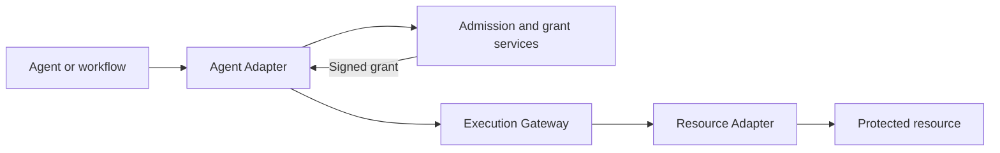

# KedgeFlow

**An open protocol and reference implementation for controlled AI agent execution.**

KedgeFlow separates an agent's proposed action from the authority to carry it out.
Control services evaluate policy and evidence, issue a signed grant for an exact
action, and let an execution gateway and resource adapter enforce that grant at
the protected resource.

The project is framework neutral: an existing agent or workflow can integrate
through the Agent Adapter without changing its reasoning engine or model provider.

> **Status:** Experimental alpha. The protocol and resource integrations are under
> development. Production use requires deployment-specific identity, credential,
> isolation and recovery controls; see the [deployment guide](docs/RUST_GATEWAY.md).

## How it works

1. **Propose:** The Agent Adapter describes the action, parameters and resource.
2. **Authorize:** Control services check policy and supporting evidence, then
   issue a scoped, time-bounded execution grant.
3. **Enforce:** The gateway verifies the grant and claims the execution attempt.
   The resource adapter applies the target's checks and performs the action.
4. **Resolve:** Retained outcomes support auditing and recovery. An uncertain
   result remains tied to the original attempt rather than triggering a new action.



## What's included

- **Rust services** for policy administration, admission, grant issuance,
  execution, credential exchange and outcome recovery.
- **Node Agent Adapter** for MCP clients, with evidence collection, grant
  persistence and retained operation status.
- **Protocol schemas and signed fixtures** for language-independent validation
  and interoperability work.
- **Resource integrations** for PostgreSQL reservations and governed Kubernetes
  drain operations, with resource-specific execution and recovery contracts.
- **A self-hosted identity pilot** using Keycloak and SPIRE.
- **A legacy Python demo** for exploring the basic proposal and grant lifecycle
  in a single process.

The Rust implementation and Node adapter use the current reference profiles.
The Python demo uses an earlier protocol and is a separate learning example.
See the [profile guide](docs/PROTOCOL_PROFILES.md) for compatibility details.

## Build from source

Install Rust and Cargo. The workspace declares Rust 1.88 as its minimum version;
its dependencies are locked in [Cargo.lock](Cargo.lock).

```sh
git clone https://github.com/openkedge/kedgeflow.git
cd kedgeflow
cargo build --locked --workspace --bins
cargo run --locked --bin kf-proxy -- --help
```

Running the services also requires deployment configuration, TLS identities,
an etcd authority ledger and the relevant target integration. Start with the
[gateway guide](docs/RUST_GATEWAY.md) and [control service guide](docs/CONTROL_SERVICE.md).
The [configuration templates](config/) contain placeholders to replace for your
environment.

## Try the Python demo

For a small local example, use Python 3.11 or newer:

```sh
python3 -m venv .venv
. .venv/bin/activate
python -m pip install -e .
kedgeflow demo
kedgeflow demo conflict
```

This demo uses in-process enforcement and does not launch the Rust services.
The [demo guide](docs/LEGACY_DEMO.md) includes a Python API walkthrough.

## Documentation

| Topic | Guide |
| --- | --- |
| Architecture | [Component boundaries](docs/architecture.md) |
| Protocol | [Schemas and validation](spec/README.md), [protocol profiles](docs/PROTOCOL_PROFILES.md) |
| Agent integration | [Node Agent Adapter](docs/AGENT_ADAPTER.md) |
| Credential exchange | [Broker service](docs/BROKER_TOKEN_SERVICE.md) |
| PostgreSQL | [Target service and configuration](docs/POSTGRES_TARGET_SERVICE.md) |
| Kubernetes | [Managed drain integration](docs/MANAGED_KUBERNETES_DRAIN.md) |
| Terraform | [Protected saved-plan inspection](docs/TERRAFORM_PLAN.md) and [original-attempt native apply](docs/TERRAFORM_APPLY.md); SDK/MCP integration remains in development |
| Identity | [Self-hosted Keycloak and SPIRE pilot](docs/SELF_HOSTED_PILOT.md) |
| Design | [White paper](docs/whitepaper/v0.9/output/pdf/kedgeflow-whitepaper.pdf), [draft RFCs](docs/rfcs/README.md) |

## Development

Python 3.11+ supports the validation tooling and Python tests. Node.js 20+ is
needed for the SDK test harness.

```sh
python -m pip install -e '.[dev,spec]'
npm ci --prefix tests/sdk
cargo fmt --all -- --check
cargo clippy --locked --workspace --all-targets -- -D warnings
pytest
python spec/validate.py
```

Rust integration tests use external fixtures, including etcd, PostgreSQL and
Kubernetes. Follow the [etcd testing guide](docs/ETCD_TESTING.md) and the relevant
integration guide to run those checks; a plain `cargo test` can skip tests whose
fixtures are absent.

## Contributing

Bug reports, documentation improvements, resource adapters and protocol feedback
are welcome. See [CONTRIBUTING.md](CONTRIBUTING.md) for the contribution workflow.
Report vulnerabilities through the process in [SECURITY.md](SECURITY.md).

## License

KedgeFlow is licensed under the [Apache License 2.0](LICENSE).
