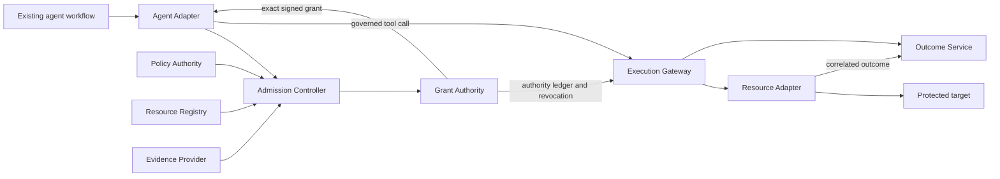

# KedgeFlow

KedgeFlow proposes component boundaries and programmable interfaces for control
over consequential agent actions. An existing agent workflow proposes an exact
action; independently administered control services admit it and issue bounded
authority; an Execution Gateway and Resource Adapter enforce the protected effect.

This repository contains the **Rust v0.9 reference gateway** and the preserved
language-independent **KF-JSON-0.2 schemas and signed fixtures**. The specification
is proposed; this implementation is a bounded reference slice of the architecture.

The [whitepaper v0.9](docs/whitepaper/v0.9/output/pdf/kedgeflow-whitepaper.pdf) is
frozen on 6 October 2026. See the [implementation handoff](docs/WHITEPAPER_IMPLEMENTATION.md)
for the Rust/Go reconciliation, pinned evidence, missing services and next milestone.
The frozen schema and all 22 shared fixture files match this repository byte for byte.
The [paper reference index](docs/REFERENCE_INDEX.md) provides pinned public artifact
links. The [initial implementation review](docs/IMPLEMENTATION_REVIEW.md) records
current coverage, remaining services and fresh required-mode test results.
The [10 October review](docs/IMPLEMENTATION_REVIEW_2026_10_10.md) compares the latest
implementation with the white paper; the [milestone plan](docs/IMPLEMENTATION_ROADMAP.md)
sequences code, protocol and enterprise integration work with release gates.
The [RFC drafts](docs/rfcs/README.md) define the first single-action contracts;
the [profile index](docs/PROTOCOL_PROFILES.md) distinguishes draft and legacy scope.



## Build and verify

Use Rust 1.88 or newer, with Cargo. Dependencies are fixed in `Cargo.lock`.

```sh
cargo build --locked --bin kf-proxy
cargo build --locked --bin kf-control
cargo build --locked --bin kf-governance
cargo run --locked --bin kf-proxy -- --help
cargo fmt --all -- --check
cargo clippy --locked --workspace --all-targets -- -D warnings
python scripts/verify-whitepaper.py
```

Run the full suite with a real three-member etcd 3.6.5 cluster and the pinned
Model Context Protocol (MCP) client software development kit (SDK):

```sh
npm ci --prefix tests/sdk
KF_REQUIRE_SDK=1 ETCD_BINARY=/absolute/path/to/etcd scripts/start-etcd.sh -- \
  cargo test --locked --workspace --all-targets -- --nocapture
```

See [real-etcd testing](docs/ETCD_TESTING.md) for prerequisites. A plain `cargo test`
explicitly skips tests requiring unconfigured external dependencies; required
mode and continuous integration fail if those dependencies are absent.

## What is implemented

- Closed, integer-only canonical JSON, Ed25519 signatures, domain-separated
  digests and all thirteen published signature/digest vectors.
- Authenticated MCP discovery, scope-filtered tool listing, admission remediation
  and protected `tools/call` under proposed `KF-MCP-0.1` and revision `2026-07-28`.
- Verified workload certificates using the Secure Production Identity Framework
  for Everyone (SPIFFE), pinned subject access tokens and Demonstrating Proof of
  Possession (DPoP) request proofs.
- Atomic etcd policy/ownership, issuance, replacement, claim, dispatch and outbox
  transactions; consumed authority survives failure, expiry and uncertain outcomes.
- RFC 8693 token exchange after claim, fixed target routing and a fenced mock
  Resource Adapter. Only a correlated terminal mock receipt establishes commit.
- Optional `KF-GRANT-REF-0.1` immutable-envelope retrieval over mutual Transport
  Layer Security (mTLS), with a pinned resolver and requester scope/size/time limits.
- Query-only reconciliation of existing unknown attempts; no mutation retry or
  allowance refund is exposed by that operation.
- Initial M2 certificate-constrained issuance library: pinned admission context,
  role-separated certificate validation and global operation-key deduplication.
  Independently verified proposal/descriptor/manifest/evidence inputs now bind
  certificate constraints and witnesses before issuance. Cedar evaluates verified
  inputs and produces durably deduplicated certificates under a separate draft ABI.
  Native HTTPS admission/issuer endpoints now authenticate workload, delegated
  subject and DPoP; atomically retain raw evidence with certificates; and generate
  grant IDs/nonces and durable resource fences. The separate administrative service
  now publishes/registers/installs signed control, retains scoped revocations and
  requires native gateway acknowledgements at authority transitions; see
  [RFC 0003](docs/rfcs/0003-admission-and-issuance.md),
  [Cedar RFC](docs/rfcs/0005-cedar-leaf-admission.md) and
  [HTTP RFC](docs/rfcs/0006-leaf-control-http.md) and
  [Enforcement Control RFC](docs/rfcs/0007-enforcement-control-http.md) and
  [fresh verification](results/verification/rfc-m2-control-2026-10-11/README.md).

The [Node Agent Adapter](docs/AGENT_ADAPTER.md) now obtains fresh evidence,
admission and issuance with the official MCP client, persists its exact grant
before execution, and resolves original attempts through a separately negotiated
status extension. See [RFC 0008](docs/rfcs/0008-agent-replay-and-status.md) and
[client verification](results/verification/rfc-m3-agent-2026-10-11/README.md).
[RFC 0009](docs/rfcs/0009-operation-status.md) now adds signed-proposal lookup
without a local grant, lost issuer/provider replies and failed grant persistence.
Full deployment qualification remains open. [RFC 0010](docs/rfcs/0010-outcome-recovery.md)
adds retained journals, a [query-only recovery worker](docs/RECOVERY_SERVICE.md),
signed outcome receipts and offline grant/receipt-chain verification. [RFC 0011](docs/rfcs/0011-outcome-report-http.md)
now adds an [authenticated collector](docs/OUTCOME_REPORT_SERVICE.md), durable
signed delivery acknowledgements and bounded reporting/lookup client.
[RFC 0012](docs/rfcs/0012-admission-lineage.md) adds retained signed admission
lineage and an [offline historical verifier](docs/ADMISSION_LINEAGE.md).
[RFC 0013](docs/rfcs/0013-control-history.md) now adds atomic governance retention
and [observer-attested history verification](docs/CONTROL_HISTORY.md).
[RFC 0014](docs/rfcs/0014-operation-control-bindings.md) adds atomic per-transition
control snapshots and [offline operation control verification](docs/CONTROL_BINDINGS.md).
[RFC 0015](docs/rfcs/0015-process-crash-qualification.md) adds nine shipping-binary
[process termination/restart cases](docs/PROCESS_CRASH_RECOVERY.md). Restore fencing,
managed crash deployment and production observer custody remain open.

The executable profile supports one nondelegated resource, one `version_eq`
predicate, `Level_A` / `FencingToken`, and `dispatch_bound` completion. Other guard
types, multiple predicates/resources, delegated grants and saga execution are
refused. A generic MCP success, tool error, timeout or asynchronous acceptance
does not prove a committed effect or prove no effect.

## Run the gateway

Provision independently trusted identity, authority, credential and target services,
then fill [the operator configuration template](config/gateway.example.json).
Keep configuration, keys, actor assertions and backing target credentials outside
the agent's authority domain.

```sh
cargo run --locked --bin kf-proxy -- --config /etc/kedgeflow/gateway.json --check
cargo run --locked --bin kf-proxy -- --config /etc/kedgeflow/gateway.json
```

`--check` validates configuration and local TLS/client material; it does not probe
remote services or publish authority. The native command-line interface (CLI)
requires HTTPS and verified client certificates. It exposes execution/discovery
only. The separate [draft control service](docs/CONTROL_SERVICE.md) exposes
authenticated admission and issuance. The separate
[administrative service](docs/GOVERNANCE_SERVICE.md) exposes authorized signed
publication/registration/installation/revocation. Managed examples require live
installed-state checks and enrolled gateway acknowledgement renewal. Legacy
publication/direct issuance/replacement ports refuse managed domains.

The RFC 8693 authorization server must implement the named KedgeFlow grant/attempt
extension before it mints target authority. The optional grant store must supply
its own publication, authorization, retention and rate controls. The target must
actually implement the declared fenced resource transaction and outcome contract.
Configuring a descriptor cannot add atomicity to a legacy target.

For local agents, loopback access and MCP routing must be paired with operating
system isolation of native shell, filesystem, socket and network paths. This
gateway installs no workstation sandbox. See [deployment and adoption](docs/RUST_GATEWAY.md)
for interfaces, remaining services and rollout gates.

## Existing Python demo

The earlier Python `0.1.0a1` package remains available as a compatibility and
learning demo. Its in-process hash-based message authentication code (HMAC)
authority and lifecycle are a different profile;
they are not converted into v0.9 execution grants by this integration.

```sh
python -m pip install -e '.[dev,spec]'
kedgeflow demo
pytest
python spec/validate.py
```

[Architecture](docs/architecture.md), [Rust verification](docs/RUST_VERIFICATION.md),
[schema and fixture tooling](spec/README.md), [legacy demo](docs/LEGACY_DEMO.md).
Licensed under [Apache 2.0](LICENSE).

The bounded M4c2 [restore gate](docs/RESTORE_QUARANTINE.md) reserves every mutating ledger transaction
in a separately retained witness before local submission. Explicit empty enrollment
and exact ready-head comparison quarantine stale or pending authority, including
recovery writes. Pending repair, migration and production deployment qualification
remain open. M4c3 now supplies bounded owned incidents and automatic delivery.

[M4c3 supervision](docs/OUTCOME_SUPERVISION.md) retains unknown-age deadlines and an operator-enrolled
owner, delivers retained receipts in order and verifies durable collector acceptance
through restart. Native software faults and shipping worker polling are qualified;
external incident routing, production identity/rotation and combined managed restore
deployment remain open. M5 identity/replay and broker prerequisites follow below.

Optional [shared authentication](docs/SHARED_AUTHENTICATION.md) adds durable DPoP
consumption across replicas and restarts, with subject/workload/scope registration.
See [RFC 0018](docs/rfcs/0018-shared-authentication.md); real identity lifecycle and
production deployment acceptance remain open.

[Broker authorization](docs/BROKER_AUTHORIZATION.md) supplies a trusted integration
library that validates the original claim and fixed target before a one-shot
credential mint. [Remaining enterprise gates](docs/ENTERPRISE_QUALIFICATION.md)
require approved provider, target, authenticator and independent-peer inputs.

[RFC 0020](docs/rfcs/0020-pinned-exchange-identities.md) adds a [pinned subject/JWT-SVID verifier](docs/EXCHANGE_IDENTITIES.md), shared
admission delegation construction and bounded atomic trust refresh. Software-key
and native-etcd tests cover these prerequisites; approved providers, target token
minting, production custody and enterprise acceptance remain open.

[RFC 0021](docs/rfcs/0021-broker-token-http.md) now adds a [native broker](docs/BROKER_TOKEN_SERVICE.md)
that accepts the shipped token-exchange client, authorizes one mint from the original
claim, and verifies a separately signed reference target credential before reply.
Actual enterprise provider/target deployment acceptance remains open.

[RFC 0022](docs/rfcs/0022-identity-refresh.md) now adds [signed identity refresh](docs/IDENTITY_REFRESH.md):
the native broker reloads authenticated snapshots against a protected exact head
for each exchange. Live actor-key rotation and rollback refusal are tested;
production publisher/head/floor custody and enterprise acceptance remain open.
