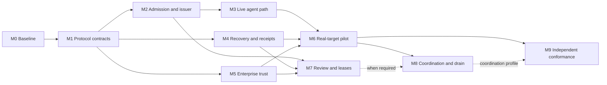

# KedgeFlow code and protocol implementation milestones

Planning baseline: **10 October 2026**, runtime `769c0a8`, proposed white paper v0.9. This plan follows the [implementation review](IMPLEMENTATION_REVIEW_2026_10_10.md). M1 now has [twenty RFC drafts](rfcs/README.md), a template, profile index and separate draft schemas. M2 has verified admission/issuance plus a bounded signed administrative control lifecycle, gateway acknowledgements and revocation comparisons. The software slice is delivered; owner acceptance and deployment qualification remain open. M3a now supplies a live official-client adapter and durable grant/attempt status; M3b adds signed-proposal operation lookup and bounded client fault qualification; M4a now adds retained journal, query-only recovery, signed receipts and an offline receipt-chain verifier; M4b1 supplies authenticated retained delivery and signed acknowledgements; M4b2 adds signed admission-lineage export and offline verification; M4b3 now retains and authenticates governance history and approved key membership; M4b4 now retains and verifies observer-attested per-transition control comparisons; M4c1 now qualifies nine shipping-binary process termination/restart boundaries; M4c2 now supplies a bounded independent write-ahead restore gate; M4c3 now supplies bounded owned incidents and automatic ordered delivery; M5a now supplies optional shared DPoP consumption and subject/workload/scope registration; M5b now supplies independent grant/original-claim/target authorization before a one-shot credential mint; M5c1 now verifies actual subject/actor signatures with bounded atomic trust refresh; approved identity lifecycle precedes enterprise acceptance.

## Execution status — 12 October 2026

| Increment | Delivered | Remaining gate |
| --- | --- | --- |
| M0 profile clarity | Active profile index; legacy v0.1 guide labelled; required etcd/SDK runtime rerun | Minimum Rust version and separate paper reproduction qualification |
| M1 RFC structure | RFCs 0001–0020; separate admission/issuance, administration and retained-status carriage | Owners, review decisions, operation lookup/outcome schemas and acceptance |
| M2a library prerequisite | Typed certificate constraints; pinned local schemas; role/tenant checks; atomic operation-wide issuance; real-etcd concurrency, rebinding, consumption and stale-policy tests | Library verification complete; service permissions still require M2b/M2c |
| M2b input verification, policy and services | Signed input chain; pinned Cedar/rules; durable certificate/chain retention; authenticated native admission/issuance; issuer-owned IDs/nonces and resource fences | Operator-approved policy/provider pins; production trust lifecycle and target qualification remain open |
| M2c control implementation | Separate authenticated signed policy/registry/install/revoke/query service; expected revisions; native gateway acknowledgement/renewal; installed scope/trust/freshness and revocation CAS in admission, allocation, issuance, claim and dispatch; native combined-path/race tests | Draft owner acceptance; multi-component coverage, production enrollment/RBAC, legacy migration, counter bootstrap and restore qualification |
| M5c1 pinned provider verification | Shared admission delegation; Ed25519 subject/ES256 JWT-SVID actor signatures; exact role/domain keys and registration; bounded atomic monotone trust refresh; key retirement/token/workload withdrawal; real-etcd broker composition | Actual approved providers/provisioning, protected refresh and independent epoch custody, cross-replica revocation delivery, native mint and actual target credential enforcement |
| M5b broker authorization | Existing one-resource leaf; independent signed grant and provider identity binding; original undispatched claim; current control/revocation CAS; immutable one-shot permit; native etcd faults | Approved provider verification/mint integration, actual target token scope, custody and production RBAC |
| M5a identity/replay | Shared atomic bounded DPoP consumption; exact subject/workload/scope registration; shipping service bindings and native restart/fault cases | Registration migration, real AS/SVID rotation, approved broker integration, production RBAC/custody and deployed bypass tests |
| M4c3 owned incidents and delivery | Retained owner/deadline and incident events; ordered verified acceptance progress; collector/process faults; shipping continuous polling | Production routing/handoff, token/identity rotation, combined managed/witness deployment, receipt pagination and latency/scale |
| M4c2 restore quarantine | Independent write-ahead reservation, local atomic head, empty operator enrollment, stale/pending refusal and separate native witness tests | Pending repair, existing-state migration, combined managed crash coverage, production RBAC/custody and independent physical failure domains |
| M4c1 process termination | Nine actual gateway/worker SIGKILL/restart cases; test-owned mTLS transaction barriers; atomic fenced software target; original attempt and receipt reuse, zero extra claims/exchanges/dispatches | M4c2 supplies bounded quarantine; managed crash/renewal coverage, full admission lineage through kills, real target durability, host/power failure, production identity/custody and independent peers |
| M4b4 operation control bindings | Atomic admission/issuance/claim/dispatch snapshot retention; governance head CAS; separate observer assertion and offline phase replay; renewal/same-clock revocation/negative carriage tests | M4c1 supplies bounded process-kill qualification; stale-backup restore fencing and observer deployment/RBAC/custody and clock trust, pagination, incidents and independent-peer acceptance |
| M4b3 governance and key history | Atomic immutable governance events; separate observer checkpoint bound to lineage; closed public historical approvals; native acknowledgement renewal/recreated service and approved issuer change; separate offline verifier | M4b4 supplies observer-attested per-transition comparisons; trusted observer deployment/clock/custody, pagination, hard-crash/restore/incident qualification |
| M4b2 signed admission lineage | Closed retained proposal/CTD/manifest/witness/certificate/grant/outcome export; public historical trust; signed-time freshness, Cedar and issuer checks; separate offline CLI; signed tenancy and explicit missing links | M4b3 supplies observer-attested governance history; M4b4 supplies observed control CAS bindings; authenticated journal/fences, original runtime authentication, target proof, wider crash/restore/incident qualification |
| M4b1 retained delivery and acknowledgement | Separate native authenticated collector; retained receipt/evidence checks; ordered immutable signed acknowledgements; bounded delivery/lookup client; duplicate/lost-reply/recreated collector cases | M4b2 supplies signed admission lineage; M4b3 supplies observed governance/key history; M4b4 supplies observed control CAS bindings; automatic delivery/incident handling, gateway/target kill matrix and restore fencing |
| M4a retained journal and outcomes | Atomic recorded execution context and claim/dispatch/terminal history; query-only indexed worker; pre-dispatch CAS seal; signed OutcomeService receipts; independent grant/receipt-chain verifier | M4b1 supplies bounded retained report/ack; M4b2 supplies signed admission lineage; M4b3 supplies observed governance/key history; M4b4 supplies observed control CAS bindings; gateway/target kill matrix, incident deadlines and restore fencing |
| M3b operation lookup and client faults | Authenticated signed-proposal historical lookup; lost issuer/provider replies; failed grant persistence; query-only restart after expiry/revocation | Full M3: real providers, power loss, crash-owner locks, retained identity/key history and restored-authority qualification |
| M3a live client and replay/status | Node Agent Adapter with real official MCP client; shared delegation audience; fresh native admission/issuance; retained grant/attempt status; original ID resolution; lost-reply and expired/revoked status after client restart | Real providers and broader persistence/deployment qualification |

The trusted legacy issuance API remains available for the existing fixture path.
M2a does not turn it into a certificate-gated service. See
[the control lifecycle verification record](../results/verification/rfc-m2-control-2026-10-11/README.md)
for fresh results. The earlier disk block is resolved. The input-chain/RFC
checkpoint is `733febf`; the Cedar/certificate checkpoint is `3a90308`.
`kf-control` produces live certificates/grants under the bounded
[HTTP draft](rfcs/0006-leaf-control-http.md). `kf-governance` now supplies the
[M2c lifecycle](rfcs/0007-enforcement-control-http.md), with native gateway
acknowledgements and serialization against issuance/claim/dispatch.
The bounded [M3a client/status increment](rfcs/0008-agent-replay-and-status.md) now
connects an actual client, aligns delegation and resolves original attempts.
The bounded [M3b operation-status increment](rfcs/0009-operation-status.md) now
resolves missing local grants and ambiguous issuer/provider replies. [M4a](rfcs/0010-outcome-recovery.md) now delivers bounded signed outcomes and
query-only recovery. [M4b1](rfcs/0011-outcome-report-http.md) adds authenticated retained
receipt delivery and signed acknowledgement/lookup. [M4b2](rfcs/0012-admission-lineage.md)
adds signed admission lineage and historical offline verification. [M4b3](rfcs/0013-control-history.md)
adds immutable governance events and observer-attested historical membership. [M4b4](rfcs/0014-operation-control-bindings.md) adds atomic operation-bound snapshots
and observer-attested control comparisons. [M4c1](rfcs/0015-process-crash-qualification.md) adds bounded process termination
and conserved query-only restart. [M4c2](RESTORE_QUARANTINE.md) adds a write-ahead
restore witness and stale/pending quarantine. [M4c3](OUTCOME_SUPERVISION.md) adds durable owned deadlines and ordered automatic delivery. [M5a](SHARED_AUTHENTICATION.md) adds shared replay and identity registration. [M5b](BROKER_AUTHORIZATION.md) adds one-shot broker authorization. Next is M5c approved provider/enterprise qualification; wider reporting/scheduling and
crash/restore qualification remain open;
wider provider/persistence gates remain open.
The full M3 release gate remains open; see the
[client verification](../results/verification/rfc-m3-agent-2026-10-11/README.md).

Deliver a complete single-action path, qualify one recoverable enterprise deployment, then demonstrate independently implemented protocol peers and coordinated workflows. Preserve fail-closed authority, consumed unknown attempts and truthful target guarantees throughout.

## Scope and estimates

Use the current one-resource mock profile to prove live admission/issuance. The first real target should be a **PostgreSQL-backed conditional reservation/update**, owned by a protected target service. This aligns with the white paper's reservation step and offers a verifiable transaction and durable operation lookup. Physical Kubernetes drain follows as a separately qualified asynchronous action.

The first SQL action should have a defined single-resource predicate. If policy depends on a shared capacity budget or other writers, M8's reservation and complete-predicate coverage become prerequisites for that deployment. A database alone does not create adapter fencing/outcome semantics.

Co-locate compatible policy/registry/admission/issuance/evidence roles in one control-plane deployment, with a protected gateway/adapter and shared ledger. Preserve distinct administrator, provider, issuer, agent and executor permissions and signing keys. Nine roles need not become nine microservices.

Estimates are **focused engineer-weeks**, including implementation and acceptance evidence. They assume existing identity infrastructure, a target owner, CI and an isolated environment. A plausible team is two Rust/backend engineers, one platform/integration engineer and part-time security/resource/application owners. These are planning ranges, not measured commitments; re-estimate after M0. Enrollment, hardware and procurement can dominate calendar time.

## Milestone overview

| Milestone | Concrete outcome | Dependencies | Effort | Accountable owner |
| --- | --- | --- | --- | --- |
| M0 | Claim inventory, active profile index and reproducible baseline | This review | 1–2 | Technical lead |
| M1 | Versioned service/wire contracts, especially Enforcement Control | M0 | 2–3 | Protocol lead + security |
| M2 | Rust policy/registry/admission and atomic independent issuer | M1 | 5–8 | Control-plane lead |
| M3 | Real Agent Adapter; fresh admission-to-mock execution; stable status/replay | M2 | 3–5 | Application integration lead |
| M4 | Crash recovery, outcome worker, signed receipts and verifiable trace | M1; integrate with M3 | 4–6 | Runtime/SRE lead |
| M5 | Enterprise identity, credential lifecycle and deployment custody | M1; integrate with M3 | 4–6 | Security/platform lead |
| M6 | Real SQL target and accepted enterprise pilot/cutover | M3, M4, M5 | 5–8 | Resource + deployment owners |
| M7 | Policy-required canonical human review and admission leases | M2, M4, M5 | 3–5 | Evidence/security lead |
| M8 | Shared reservations, delegation, saga recovery and governed drain | M6; M7 when review required | 7–12 | Authority/workflow lead |
| M9 | Independent exchange, second runtime/target and release conformance | M6 leaf profile; M8 coordination profile | 4–7 | Protocol/release lead |

M0–M6 total **24–38 engineer-weeks**; all milestones total **38–62 engineer-weeks**. M4/M5 can proceed alongside M2/M3 after contract agreement. Extra staffing does not divide the critical path linearly.

## M0 — Reproducible baseline and claim inventory

**Code/evidence:** provision a pinned Rust toolchain and run the active workspace with real three-member etcd and required official MCP SDK. Reproduce paper tests separately without overwriting published results. Add supported toolchain/OS checks, including the declared Rust minimum or revise it with evidence. Record source/tool versions, dependency hashes, commands, skips and raw logs.

**Protocol/documentation:** label `docs/protocol.md` as the legacy Python v0.1 guide. Publish an active profile index with accepted record, transport, guard and completion variants. Map every manuscript capability to an owner, code, acceptance case and milestone; keep frozen/current/historical evidence distinct.

**Exit:** another developer reproduces the declared baseline without accidental optional skips. Every claim has a pinned source and scope. Retained Rust results remain clearly identified as retained.

## M1 — Implementable contracts for all six interfaces

**Code:** introduce typed service requests/responses, validators and role/scoped trust administration. Separate execution, administrative and evidence permissions. Define durable operation/attempt lookup types without exposing issuer/publication methods to agents.

**Protocol:** specify machine-readable HTTP/RPC bindings for Governance, Runtime Admission, Enforcement Control, Evidence, Execution status and Outcome. Fix caller permissions, version negotiation, closed payloads, signing domains, key history, errors, expected versions, idempotency, clock uncertainty, cancellation and unknown states. Specify the custom RFC 8693 grant/digest/attempt fields, server-side claimed-attempt validation and subject/workload downscoping.

Prioritize **Enforcement Control**: authenticated `install`, expected installed version, policy/descriptor/key/grant/revocation scope, acknowledgements of actual installed version/coverage and stale-state refusal. Retain shared authoritative etcd as the first claim/revocation substrate. Installed caches never authorize local redemption when quorum is unavailable; an acknowledgement cannot cancel an already dispatched effect.

Freeze the supported methods, authentication and transport for the pinned MCP revision. Specify status usable after grant expiry under current caller authorization. Define optional reference-store publication/retrieval ACLs and retention.

**Exit:** positive/negative vectors and authorization tests cover every leaf-profile operation; wrong-scope/rollback installs refuse and acknowledgement coverage is truthful. New records or changed signed meanings require a new proposed version/supplement. Preserve frozen v0.9 bytes and do not reuse a schema ID for changed semantics.

## M2 — Rust admission and independent atomic issuance

**Code:** implement Policy Authority/Resource Registry functions for one action, then Admission Controller and Grant Authority services. Co-location is allowed with distinct permissions/keys. Add typed semantic validation for signed proposals, CTDs, manifests, evidence and certificates against pinned local schemas. Verify signer roles, identity/delegation, action/incarnation, descriptor/parameter digests, current policy/ownership and approved constraints.

Use satisfied/violated/unknown obligations. Emit a certificate only when required evidence is satisfied and policy permits. Integrate one engine first, preferably Cedar to reuse paper behavior; use server-constructed verified inputs and deny on diagnostics. Qualify OPA as a later interchangeable implementation.

The issuer verifies the complete proposal/certificate/constraint chain and intersects audience, guard, completion, lifetime and evidence validity. Atomically deduplicate one admitted operation/budget using an independently derived issuance key. Repeated valid requests return the persisted issuance; conflicting bindings refuse. New caller request/root IDs cannot multiply allowance. Retain deduplication through the replay/outcome horizon. Only the authority service chooses/publishes roots, generations, nonces and fences.

**Protocol:** implement authorized publish/register/revoke and install/acknowledgement. Explicit grant/root/scope revocation should not require fabricated grant-shaped policy updates. Define retryable issuance responses without reopening authority.

**Exit:** live services produce schema-valid signed certificates/grants. Missing, expired, unknown or contradictory required evidence cannot admit. Wrong-role signatures, broadened constraints, old descriptors and evaluation diagnostics refuse. Concurrent issuer replicas receiving one admission with different request/root IDs produce one persisted allowance. Revocation races issuance/claim/final dispatch obey the declared serialization contract.

## M3 — Live Agent Adapter and correct replay/status correlation

**Code:** integrate one actual supported harness/client workflow. Authenticate workload/delegated subject; freeze proposals; validate negotiated remediation and trusted admission endpoints; obtain fresh evidence, certificate and grant; retry the unchanged action with fresh DPoP proofs. Preserve stable operation identity and expose denied, missing-evidence, pending and unknown states faithfully.

Correct the `NonceConsumed` path to return or resolve the original persisted attempt. Resolve ambiguous claim replies similarly. Expose scope-authorized query-only status by operation/grant/attempt identity without requiring a still-executable grant. Current authorization controls disclosure; status never dispatches. New RPC IDs do not create authority.

**Protocol:** finalize remediation expiry, changed-action/new-admission behavior, status result/error types, cancellation and safe retry rules under M1's binding.

**Exit — first release gate:** a real client performs discovery → remediation → fresh evidence → admission → issuance → exact call → mock receipt without fixture grants. Identity/parameter changes require new admission. Lost-response retry resolves the original attempt. Repeated status and expired-grant status cause **zero additional claims, credential exchanges or target mutations**. Unsupported clients cannot bypass the pilot target.

## M4 — Crash recovery, signed outcomes and independent reconstruction

**Code:** persist signed authorization links, adapter/version, identity/correlation context, dispatch intent, target operation references and observations. Replace an overwritten status-only outbox with retained transition/report records where required. Add a supervised worker that discovers stranded `claimed` and unknown attempts, with atomic transitions and safe multi-worker ownership.

Distinguish provably undispatched work from possible sends using durable facts and the adapter's contract. Query authoritative status; insufficient evidence remains consumed unknown. Time, cancellation, missing status or process death cannot prove no effect. Do not implicitly redispatch/refund.

Produce signed KF-JSON Receipts; implement idempotent Outcome reporting/acknowledgement, target queriers, contradictory-evidence retention, bounded polling and owned escalation deadlines. Preserve actual target evidence: gateway signatures do not become target-signed commit proof. Add an offline verifier for proposal → evidence → certificate → grant → claim/dispatch → outcome, with missing links explicit.

**Protocol:** specify recovery transitions, report identity/order, terminal/pending/unknown semantics, retention/key history and late-effect/no-effect barriers. Define authority-preserving quiesce/restore. Initially, consumed allowance can remain held indefinitely; safe restoration/compensation needs additional proven contracts.

**Exit:** kill/restart before/after claim, dispatch authorization, target commit and receipt persistence. Duplicate workers/reports do not duplicate effects. Lost commit replies resolve authoritatively or remain consumed unknown with an incident. Stale backups are fenced/quarantined before execution resumes. A separate verifier reconstructs retained lineage.

### M4c crash and restore qualification

1. **M4c1 — Process termination (bounded slice delivered):** controlled child-process barriers before
   and after claim, dispatch authorization, target reply and receipt persistence.
   [Nine shipping-binary tests](PROCESS_CRASH_RECOVERY.md) kill and restart the
   gateway/worker in unmanaged fixture mode. Recover the original attempt with
   zero additional claims, credential exchanges or target dispatches; retain an
   explicit unknown outcome where authoritative query cannot resolve it.
2. **M4c2 — Restore quarantine (bounded slice delivered):** [RFC 0016](rfcs/0016-restore-quarantine.md)
   and the [write-ahead gate](RESTORE_QUARANTINE.md) reserve every mutating transaction
   in an independently retained witness, then stamp local state atomically. Empty
   enrollment and latest-head checks refuse stale backups, pending reservations and
   missing witnesses. Tests preserve consumed roots/fences using separate software
   clusters. Pending repair, live migration and production failure domains remain open.
3. **M4c3 — Owned incidents and delivery (bounded slice delivered):** [RFC 0017](rfcs/0017-outcome-supervision.md)
   and [supervision](OUTCOME_SUPERVISION.md) retain an operator-enrolled owner, first
   unknown deadline and immutable incident events. Ordered delivery verifies signed
   collector acknowledgements and resumes exact progress after faults. Native tests
   include shipping supervisor SIGKILL/restart and continuous polling. External
   routing/handoff, managed witness integration and production guarantees remain open.

## M5 — Enterprise identity, credential lifecycle and custody

**M5a — Identity/replay prerequisites (bounded slice delivered):** [RFC 0018](rfcs/0018-shared-authentication.md)
and [shared authentication](SHARED_AUTHENTICATION.md) implement optional durable
DPoP consumption and exact subject/workload/scope registration with fail-closed
replica, restart and fault comparisons. This is a software prerequisite;
real authorization-server/SVID provisioning, rotation and enterprise deployment
acceptance still require independently approved infrastructure.

**M5b — Broker authorization prerequisite (bounded slice delivered):**
[RFC 0019](rfcs/0019-broker-authorization.md) and the [trusted broker library](BROKER_AUTHORIZATION.md)
independently validate signed grant, verified provider identity, original claimed
attempt and fixed target, with one immutable authorization CAS before minting.

**M5c1 — Pinned verification prerequisite (bounded slice delivered):**
[RFC 0020](rfcs/0020-pinned-exchange-identities.md) and [exchange identities](EXCHANGE_IDENTITIES.md)
verify the existing subject-token signature and ES256 JWT-SVID actor with approved
role/domain keys, shared canonical delegation, atomic monotone trust replacement,
freshness bounds and explicit registration/token withdrawal. Software keys and
a real-etcd original-claim composition qualify the library.

Next is **M5c — Approved providers and enterprise qualification**. Implement the
actual provider verification/mint integration and qualify the approved AS,
SVID and target contracts. [Required inputs and acceptance evidence for M5c–M9](ENTERPRISE_QUALIFICATION.md)
are explicit; fixture-only checks cannot close these gates.

**Code:** integrate one real authorization server with controlled issuer/audience/algorithm policy, key rollover and subject-to-workload authorization. Integrate SPIFFE/SPIRE or equivalent administered SVID provisioning/rotation. Add shared atomic DPoP replay/nonce state with bounded retention and fail-closed outages. Keep process-local replay only for its declared profile.

Implement broker-side grant/attempt validation and one real target credential binding. Verify effective target scope/audience/lifetime through the provider's actual token/introspection contract where applicable, retaining final validity checks. Separate issuer/gateway/recovery identities and least-privilege ledger roles so the gateway cannot self-issue. Support secret/certificate/etcd-token renewal and operational key custody.

If reference carriage is needed, implement authorized immutable publication/retrieval, ACLs, rate/concurrency caps, retention and audit. Otherwise keep it disabled for the pilot.

**Deployment/protocol:** supply a supported isolation package, protected service identity/configuration, fixed egress/target access and native shell/file/socket/SDK bypass tests. Declare separately administered break-glass writers. Document rotation, clock uncertainty, TLS termination and actual intermediary/header budgets.

**Exit:** real identity/broker services work end to end. Rotation, revoked workload, cross-replica/restart proof replay, provider outage, overbroad token and exhausted validity refuse unsafe dispatch. Agents/descendants cannot obtain equivalent target credentials, access privileged sockets, tamper with the gateway or invoke alternate mutation paths. Production etcd TLS/RBAC is tested.

## M6 — Real SQL adapter and accepted enterprise pilot

**Code:** replace mock parameter binding with closed CTD-driven action validation/mapping. Supply adapter `describe`, `dispatch` and authoritative `query`. Use fixed target/query/executable definitions rather than caller-controlled SQL or routing.

Implement a PostgreSQL transaction checking declared incarnation/version/fence, applying the effect and retaining attempt/grant/result correlation atomically. Define fence allocation for the covered writer set. Target-side attempt deduplication/retention are resource guarantees, not consequences of an etcd claim. Qualify the ledger/target transaction boundary with M4.

**Protocol:** freeze action, parameter schema, guard, completion, idempotency and outcome contracts with truthful Level A scope. Apply versioning rules when parameters/contracts change. Define actual writer coverage, revocation behavior and evidence. Report only reservation/update completion until physical drain is implemented.

**Exit — enterprise pilot gate:** validate concurrent writers, state changes, deletion/recreation, lost responses, delayed exchange, partitions, target restart and stale restore on a real isolated target. Independent query confirms actual commit. Deployed bypass tests pass. If shared-budget policy applies, M8 is also required.

Deployment/security/SRE/resource owners accept scope, writer coverage, trust, retention, incident deadlines, on-call and cost records. Set workload budgets before measuring admission/issuance/claim/exchange/target/query latency, human queue time, false refusals, unresolved age and support effort.

Use observe → isolated governed pilot → accepted privilege cutover. Production cutover requires rehearsed abort/upgrade/restore/exit preserving consumed roots and key histories. Observation alone makes no enforcement claim.

## M7 — Policy-required canonical review and non-authorizing leases

**Code:** port WebAuthn review into the Rust service path, binding proposal/parameters, policy, template/rendered bytes, reviewer/verdict, nonce and expiry. Provide protected rendering, actual browser ceremony, trusted enrollment/attestation provenance, reviewer revocation and durable atomic challenge/counter consumption. Software fixtures remain test-only.

Implement exact-proposal AdmissionLease reuse for valid static obligations; invalidate on membership, policy, descriptor, delegation or evidence changes. Acquire fresh JIT witnesses before final admission. Leases confer no execution nonce, credential or allowance.

**Exit:** physical enrolled-authenticator ceremony works; wrong RP/origin/rendering, substitution, missing UV, replay, expiry, revoked enrollment and unsupported hardware/backup policy refuse. Replicas/restarts permit one challenge consumption. Expired underlying evidence blocks admission despite a present lease.

This milestone is required before any pilot claims hardware-bound review. A no-human-review leaf profile may ship after M6 with that scope explicit.

## M8 — Shared reservations, A2A delegation and saga/drain recovery

**Code:** add atomic conflict-domain reservations and admitted-operation/child-allocation deduplication. Conserve free, allocated, consumed, unresolved and compensation allowances under one parent generation. Composite parents cannot execute/spend child allocations; transfer/replacement cannot reopen unresolved authority. Qualify multiple-resource/predicate profiles before accepting them.

Implement A2A AgentCard extension advertisement/activation and authenticated root-reference resolution. Task IDs/references are correlation, not authority; each child needs a narrower admitted grant. Demonstrate scope narrowing and refusal of widening.

Integrate durable orchestration, optionally Temporal, with stable operation identities and query-first recovery. Reserve compensation budget before forward execution. Registered inverses require known outcomes, fresh admission, accepted applicability and late-effect barriers where needed.

Implement the paper's **separate Kubernetes drain** action: narrowly scoped credential, durable controller operation, cordon/eviction and authoritative observed completion. Declare Level C physical limits instead of inheriting SQL Level A. Account for schedulers, autoscalers, humans and other writers before broader availability claims. Uncordon does not restore evicted workloads.

**Exit:** last-slot competitors cannot both spend capacity under the complete declared writer/predicate boundary. Nested/parallel delegation conserves budgets. New A2A task IDs cannot duplicate child allocation. Crash, late effect, partial compensation and compensation failure remain explicit. Unknown forward effects never trigger blind retry, inverse execution or timer refunds.

Cross-cluster ownership/reservations require a further coordination/transfer profile; prefixes, regions and separate local transactions do not establish atomic global allocation.

## M9 — Independent interoperability and release conformance

**Code:** publish a conformance runner, negative/fault corpus and trace verifier. Add a second actual runtime adapter and target/credential binding. An independently implemented controller must exchange install/admission/issuance/status/outcome with Rust; another configuration of the same implementation is insufficient proof of independence.

**Protocol:** publish a proposed release with capability matrix, schemas, migration/key rules, security/operations assumptions and reproducible evidence. Test governed MCP/reference carriage through actual intermediaries and A2A peers for the coordination profile. List unsupported variants explicitly.

**Exit:** independent peers pass positive/negative wire exchange, stale install/revocation and lost-response tests. Upgrade/rotation/export/restore retain consumption and original signed history. Another implementer reproduces release evidence. Claims name exact runtimes, targets and protocol variants.

Comparative efficacy/performance requires a separately specified hardened PDP/PEP baseline with equivalent isolation, evidence, exact binding, coordination, guards and recovery. Report attempted, claimed, dispatched, committed, refused and unresolved populations separately. The retained contention matrix is not enterprise mutation-throughput evidence.

## First implementation backlog

1. M0 toolchain/required-mode reproduction and active/legacy protocol index.
2. M1 leaf service contract and operation/authorization model, prioritizing Enforcement Control and status.
3. Typed proposal/CTD/evidence/certificate validation and durable admitted-operation issuance key.
4. Independently authorized admission/issuer/control endpoints with scoped revocation and version acknowledgement.
5. M3a retained grant/attempt resolution is delivered; M3b signed-proposal lookup now resolves missing local grants and lost issuer replies.
6. M3a Node live admission/issuance is delivered for the mock profile; M3b qualifies lost provider replies and failed grant persistence; real providers, power loss and restore remain open.
7. Recovery context/process-kill matrix alongside real identity/broker integration.

Each accepted gate updates the claim inventory with actual results, source/profile versions and owners. An incomplete gate leaves that capability unsupported; continue refusing inputs whose invariants have not been implemented.
